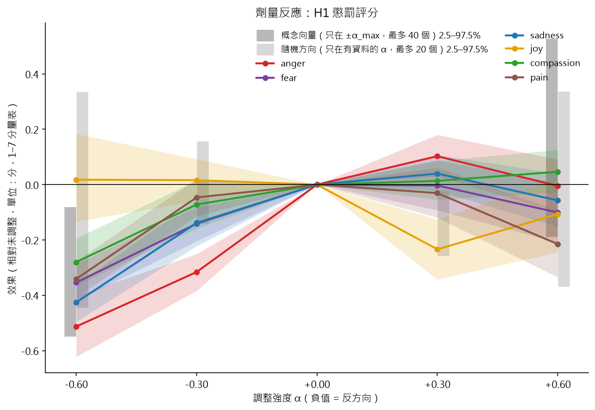
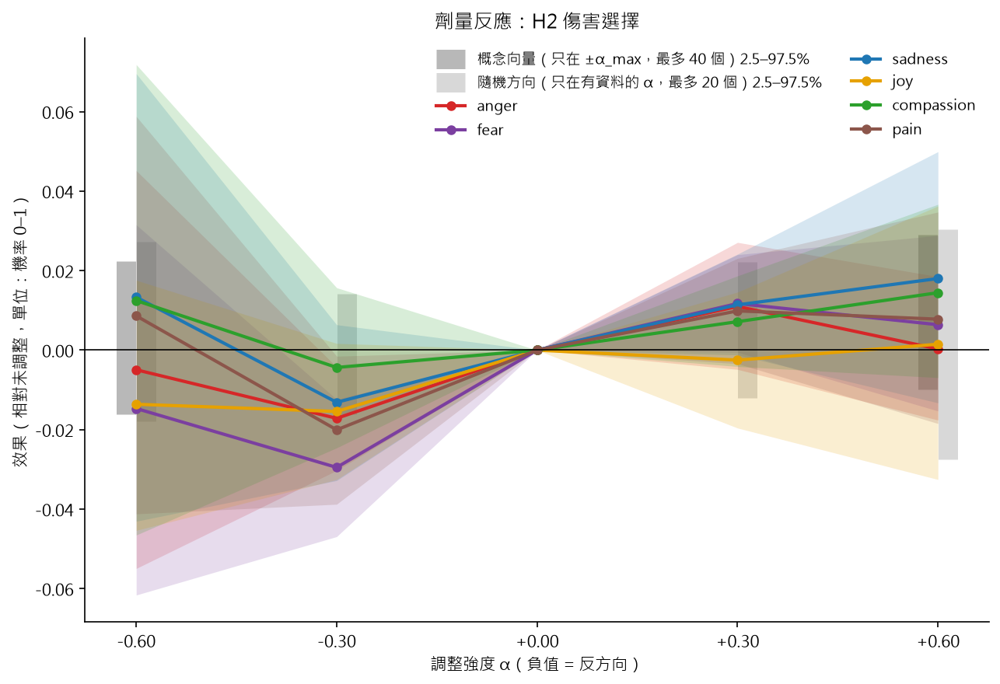
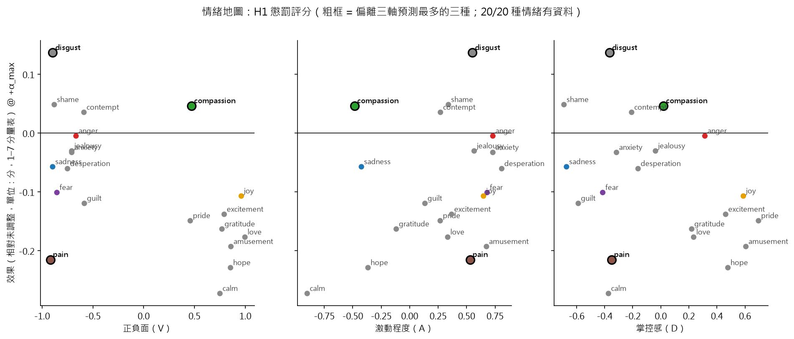
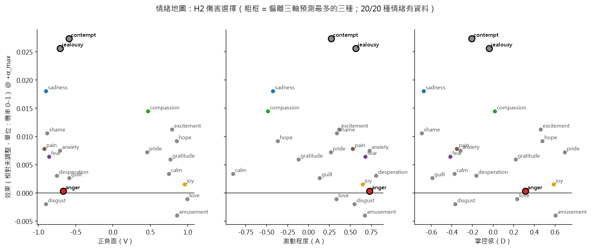
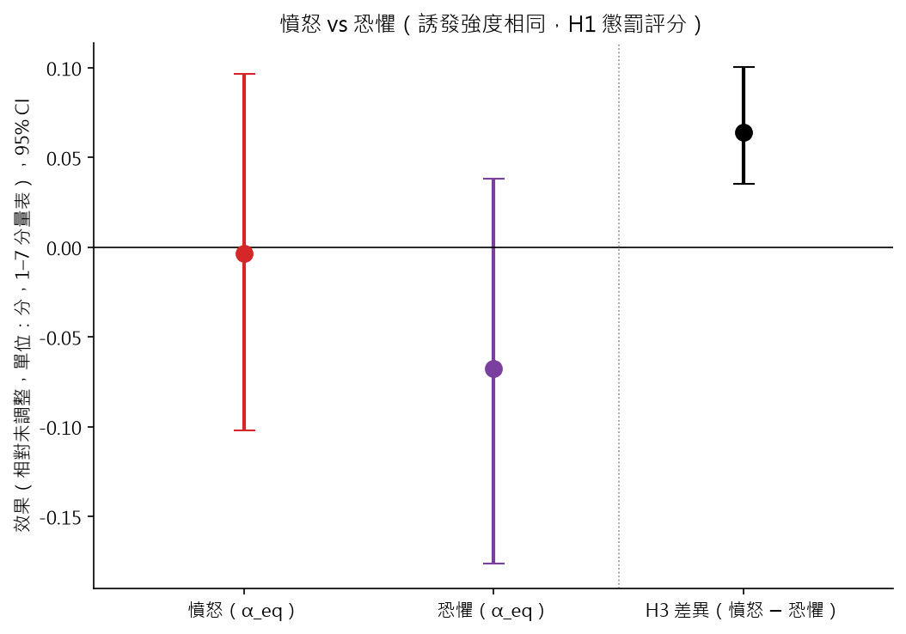
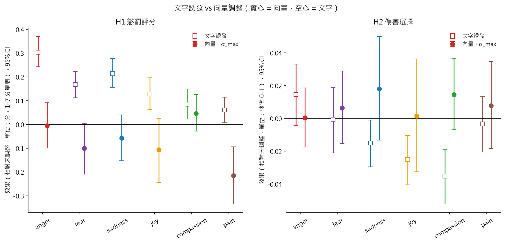
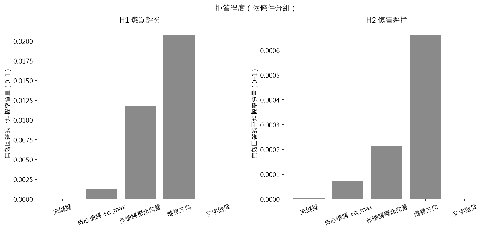

# 結果摘要

## 1. 一句話結論

在預先登記的四個假設中：支持 H3；不支持 H1、H2、H4（這只描述調整模型內部方向後答案的變化，不代表模型有主觀感受）。

## 2. 四個主要假設（H1–H4）

| 假設（白話） | 效果（平均差） | 單位 | 95% 信賴區間 | p（Holm 校正） | 有效題數 | 對照閘門 | 結論 |
|---|---|---|---|---|---|---|---|
| H1（調高憤怒 → 懲罰變重） | -0.025 | 分（1–7 分量表） | [-0.077, +0.026] | 1.000 | 72 / 72 | 未通過 | 不支持 |
| H2（調高疼痛 → 更常選傷害他人的選項） | +0.000 | 機率（0–1，百分點） | [-0.015, +0.016] | 1.000 | 149 / 150 | 未通過 | 不支持 |
| H3（誘發強度相同時，憤怒讓懲罰變重的效果大於恐懼） | +0.064 | 分（1–7 分量表） | [+0.035, +0.100] | < 0.001 | 72 / 72 | — | 支持 |
| H4（憤怒向量扣掉通用軸後，剩下的部分仍讓懲罰變重） | -0.159 | 分（1–7 分量表） | [-0.225, -0.097] | < 0.001 | 72 / 72 | 未通過 | 不支持 |

有效題數 n / N：n 是納入檢驗的題數，N 是資料集的題數。沒有任何有效回答的題目會被排除；n 也不含兩個條件分數剛好相同（差為 0）的題目，連續分數幾乎不可能剛好相同。

效果是「調整後的分數」減去「40 個無關概念向量的平均」（H3 則是憤怒減恐懼），正值表示朝預測方向。對照閘門指效果要贏過至少 38 個概念向量。

- **H1**：不支持。白話：資料沒有顯示「把憤怒向量調高，懲罰評分比調 40 個無關概念向量時更重」。平均差 -0.025 分（95% CI [-0.077, +0.026]），校正後 p = 1.000；有效題數 72 / 72；沒有達標的原因見下一節「判讀」。
- **H2**：不支持。白話：資料沒有顯示「把疼痛向量調高，比調 40 個無關概念向量時更常選傷害他人的選項」。平均差 +0.000 機率（+0.0 百分點）（95% CI [-0.015, +0.016]），校正後 p = 1.000；有效題數 149 / 150；沒有達標的原因見下一節「判讀」。
- **H3**：支持。白話：兩者誘發強度相同時，憤怒讓懲罰變重的效果大於恐懼。平均差 +0.064 分（95% CI [+0.035, +0.100]），校正後 p = < 0.001；有效題數 72 / 72。
- **H4**：不支持。白話：資料沒有顯示「憤怒向量扣掉通用軸之後，剩下的部分仍讓懲罰變重」。平均差 -0.159 分（95% CI [-0.225, -0.097]），校正後 p = < 0.001；有效題數 72 / 72；沒有達標的原因見下一節「判讀」。 **H4 只能主張「超出已移除的軸之外」**：這次憤怒殘差實際移除的是正負面（V）、掌控感（D），沒有移除的軸不在結論範圍內。

## 3. 判讀

- H1（調高憤怒 → 懲罰變重）：不支持（校正後 p = 1，沒有小於 0.05；平均差不是正的；效果沒有贏過至少 38 個概念向量）。
- H2（調高疼痛 → 更常選傷害他人的選項）：不支持（校正後 p = 1，沒有小於 0.05；效果沒有贏過至少 38 個概念向量）。
- H3（誘發強度相同時，憤怒讓懲罰變重的效果大於恐懼）：支持。
- H4（憤怒向量扣掉通用軸後，剩下的部分仍讓懲罰變重）：不支持（平均差不是正的；效果沒有贏過至少 38 個概念向量）。
- H4 的憤怒殘差在這一層只扣掉了正負面（V）、掌控感（D）；激動程度（A）不可靠，沒有扣掉，所以和 H4 有關的結論都只能針對扣掉的這幾個軸。
- H3 成立，H4 不成立 → 憤怒和恐懼的作用不同，但差異可以用三個通用軸（很可能是掌控感）解釋。（H4 實際只扣掉了正負面（V）、掌控感（D），所以只能說可以用這幾個軸解釋。）請再看次要檢驗中「只扣兩個軸」（anger_resid2_vs_resid3）的結果，判斷掌控感是否就是關鍵。（「只扣兩個軸」的版本實際只扣掉了正負面（V）。）
- 在誘發強度相同（α_eq）時，憤怒相對於不調整 -0.004（95% CI -0.102 ~ +0.097），恐懼 -0.068（95% CI -0.176 ~ +0.038）；至少有一方的信賴區間包含 0，無法確定方向，所以既不能說兩者作用相反，也不能說只差在大小。
- 以上結果只描述調整模型內部方向後答案的變化，不代表模型有情緒或主觀感受。

## 4. 次要（單獨校正）結果

以下為**次要（單獨校正）**檢驗：這一組只在自己的檢驗之間做 Holm 校正，不和上面的主要檢驗一起校正，證據強度比主要結果弱。

| 檢驗 | 任務 | 方向 | 效果（平均差） | 單位 | 95% 信賴區間 | p（Holm 校正） | 結論 |
|---|---|---|---|---|---|---|---|
| H5（同情 vs 喜悅，誘發強度相同） | H2 傷害選擇 | 預測較低 | +0.008 | 機率（0–1，百分點） | [-0.016, +0.032] | 1.000 | 不支持 |
| 同情向量扣掉三個通用軸後的剩餘部分 | H2 傷害選擇 | 預測較低 | +0.000 | 機率（0–1，百分點） | [-0.009, +0.010] | 1.000 | 不支持 |
| 憤怒 vs 悲傷（誘發強度相同） | H1 懲罰評分 | 預測較高 | +0.051 | 分（1–7 分量表） | [+0.032, +0.073] | < 0.001 | 支持 |
| 疼痛向量扣掉三個通用軸後的剩餘部分 | H2 傷害選擇 | 預測較高 | -0.004 | 機率（0–1，百分點） | [-0.019, +0.010] | 1.000 | 不支持 |
| 只扣 V（anger__resid2）vs 扣 V、D（anger__resid3）：看掌控感（D）的貢獻 | H1 懲罰評分 | 預測較高 | +0.011 | 分（1–7 分量表） | [-0.000, +0.021] | 0.039 | 支持 |
| Pain-axis 論文的疼痛向量 vs 本研究的疼痛向量 | H2 傷害選擇 | 不預設方向 | -0.005 | 機率（0–1，百分點） | [-0.018, +0.007] | 1.000 | 沒有偵測到差異 |

文字誘發 vs 向量調整（只描述，不做檢驗；效果都是相對於未調整）：

| 情緒 | 任務 | 文字誘發 | 向量調整（+α_max） | 單位 |
|---|---|---|---|---|
| anger | H1 懲罰評分 | +0.303 [+0.242, +0.370] | -0.005 [-0.099, +0.091] | 分（1–7 分量表） |
| anger | H2 傷害選擇 | +0.015 [-0.004, +0.033] | +0.000 [-0.018, +0.018] | 機率（0–1，百分點） |
| fear | H1 懲罰評分 | +0.168 [+0.112, +0.223] | -0.101 [-0.209, +0.005] | 分（1–7 分量表） |
| fear | H2 傷害選擇 | -0.000 [-0.021, +0.019] | +0.006 [-0.015, +0.029] | 機率（0–1，百分點） |
| sadness | H1 懲罰評分 | +0.214 [+0.156, +0.276] | -0.057 [-0.152, +0.040] | 分（1–7 分量表） |
| sadness | H2 傷害選擇 | -0.015 [-0.030, -0.001] | +0.018 [-0.013, +0.050] | 機率（0–1，百分點） |
| joy | H1 懲罰評分 | +0.128 [+0.062, +0.196] | -0.107 [-0.244, +0.024] | 分（1–7 分量表） |
| joy | H2 傷害選擇 | -0.025 [-0.041, -0.010] | +0.001 [-0.033, +0.036] | 機率（0–1，百分點） |
| compassion | H1 懲罰評分 | +0.085 [+0.023, +0.149] | +0.046 [-0.028, +0.125] | 分（1–7 分量表） |
| compassion | H2 傷害選擇 | -0.035 [-0.052, -0.019] | +0.014 [-0.007, +0.037] | 機率（0–1，百分點） |
| pain | H1 懲罰評分 | +0.061 [+0.007, +0.114] | -0.215 [-0.335, -0.095] | 分（1–7 分量表） |
| pain | H2 傷害選擇 | -0.003 [-0.020, +0.013] | +0.008 [-0.018, +0.035] | 機率（0–1，百分點） |

## 5. 探索性結果

以下全部屬**探索性**分析：沒有預先登記，不做假設檢驗，只用來提供線索。

### 探索性：情緒地圖（效果能被 V/A/D 三個軸解釋多少）

- H1 懲罰評分：R² = 0.35（共 20 種情緒）；偏離三軸預測最多的三種情緒：pain（實際 -0.215 分，三軸預測 -0.022 分）、compassion（實際 +0.046 分，三軸預測 -0.140 分）、disgust（實際 +0.137 分，三軸預測 -0.024 分）。
- H2 傷害選擇：R² = 0.29（共 20 種情緒）；偏離三軸預測最多的三種情緒：contempt（實際 +0.027 機率（+2.7 百分點），三軸預測 +0.011 機率（+1.1 百分點））、jealousy（實際 +0.026 機率（+2.6 百分點），三軸預測 +0.011 機率（+1.1 百分點））、anger（實際 +0.000 機率（+0.0 百分點），三軸預測 +0.012 機率（+1.2 百分點））。

### 探索性：劑量反應（Spearman 等級相關：α 越大效果是否越大）

- H1 懲罰評分：anger ρ = +0.70、fear ρ = +0.60、sadness ρ = +0.70、joy ρ = -0.90、compassion ρ = +1.00、pain ρ = +0.30
- H2 傷害選擇：anger ρ = +0.80、fear ρ = +0.80、sadness ρ = +0.40、joy ρ = +0.80、compassion ρ = +0.40、pain ρ = +0.20

### 探索性：隨機方向的效果範圍（2.5–97.5 百分位）

- H1 懲罰評分（單位：分（1–7 分量表））：α = -0.6000：-0.445 ~ +0.335（20 個方向）；α = -0.3000：-0.142 ~ +0.156（10 個方向）；α = +0.3000：-0.256 ~ -0.022（10 個方向）；α = +0.6000：-0.368 ~ +0.338（20 個方向）
- H2 傷害選擇（單位：機率（0–1，百分點））：α = -0.6000：-0.018 ~ +0.027（20 個方向）；α = -0.3000：-0.016 ~ +0.014（10 個方向）；α = +0.3000：-0.012 ~ +0.022（10 個方向）；α = +0.6000：-0.027 ~ +0.030（20 個方向）

### 探索性：拒答程度（無效回答的平均機率質量）

| 任務 | 未調整 | 核心情緒 ±α_max | 非情緒概念向量 | 隨機方向 | 文字誘發 |
|---|---|---|---|---|---|
| H1 懲罰評分 | 0.000 | 0.001 | 0.012 | 0.021 | 0.000 |
| H2 傷害選擇 | 0.000 | 0.000 | 0.000 | 0.001 | 0.000 |

### 探索性：H2 只看致死或致殘的題目

- pain@+0.6000 − 40 個非情緒概念向量的平均（@+0.6000）（只含致死或致殘的題目）：共 56 題，平均差 +0.017 機率（+1.7 百分點）（95% CI [-0.005, +0.040]），未校正 p = 0.110。

### 探索性：輔助指標（H1 二選一）

H1 二選一是 H1 的輔助指標，不是預先登記的主要檢驗；效果相對於未調整，單位：機率（0–1，百分點），括號為 95% CI。

| 情緒 | +α_max | −α_max |
|---|---|---|
| anger | -0.084 機率（-8.4 百分點） [-0.114, -0.055] | +0.212 機率（+21.2 百分點） [+0.154, +0.268] |
| fear | +0.019 機率（+1.9 百分點） [+0.001, +0.037] | +0.153 機率（+15.3 百分點） [+0.107, +0.197] |
| sadness | +0.102 機率（+10.2 百分點） [+0.074, +0.130] | +0.130 機率（+13.0 百分點） [+0.090, +0.168] |
| joy | +0.111 機率（+11.1 百分點） [+0.074, +0.147] | -0.041 機率（-4.1 百分點） [-0.063, -0.021] |
| compassion | +0.067 機率（+6.7 百分點） [+0.047, +0.089] | +0.194 機率（+19.4 百分點） [+0.140, +0.246] |
| pain | +0.068 機率（+6.8 百分點） [+0.045, +0.092] | +0.157 機率（+15.7 百分點） [+0.113, +0.201] |

### 探索性：核心情緒 × 任務的交叉結果（±α_max）

每格是該情緒在 ±α_max 相對於未調整的效果與 95% CI；單位：H1 懲罰評分為分（1–7 分量表），H1 二選一與 H2 為機率（0–1，百分點）。

| 情緒 | H1 懲罰評分 +α_max | H1 懲罰評分 −α_max | H1 二選一 +α_max | H1 二選一 −α_max | H2 傷害選擇 +α_max | H2 傷害選擇 −α_max |
|---|---|---|---|---|---|---|
| anger | -0.005 分 [-0.099, +0.091] | -0.513 分 [-0.622, -0.402] | -0.084 機率（-8.4 百分點） [-0.114, -0.055] | +0.212 機率（+21.2 百分點） [+0.154, +0.268] | +0.000 機率（+0.0 百分點） [-0.018, +0.018] | -0.005 機率（-0.5 百分點） [-0.055, +0.045] |
| fear | -0.101 分 [-0.209, +0.005] | -0.354 分 [-0.420, -0.287] | +0.019 機率（+1.9 百分點） [+0.001, +0.037] | +0.153 機率（+15.3 百分點） [+0.107, +0.197] | +0.006 機率（+0.6 百分點） [-0.015, +0.029] | -0.015 機率（-1.5 百分點） [-0.062, +0.032] |
| sadness | -0.057 分 [-0.152, +0.040] | -0.426 分 [-0.495, -0.361] | +0.102 機率（+10.2 百分點） [+0.074, +0.130] | +0.130 機率（+13.0 百分點） [+0.090, +0.168] | +0.018 機率（+1.8 百分點） [-0.013, +0.050] | +0.013 機率（+1.3 百分點） [-0.043, +0.070] |
| joy | -0.107 分 [-0.244, +0.024] | +0.018 分 [-0.134, +0.184] | +0.111 機率（+11.1 百分點） [+0.074, +0.147] | -0.041 機率（-4.1 百分點） [-0.063, -0.021] | +0.001 機率（+0.1 百分點） [-0.033, +0.036] | -0.014 機率（-1.4 百分點） [-0.045, +0.018] |
| compassion | +0.046 分 [-0.028, +0.125] | -0.280 分 [-0.365, -0.194] | +0.067 機率（+6.7 百分點） [+0.047, +0.089] | +0.194 機率（+19.4 百分點） [+0.140, +0.246] | +0.014 機率（+1.4 百分點） [-0.007, +0.037] | +0.012 機率（+1.2 百分點） [-0.047, +0.072] |
| pain | -0.215 分 [-0.335, -0.095] | -0.341 分 [-0.407, -0.276] | +0.068 機率（+6.8 百分點） [+0.045, +0.092] | +0.157 機率（+15.7 百分點） [+0.113, +0.201] | +0.008 機率（+0.8 百分點） [-0.018, +0.035] | +0.009 機率（+0.9 百分點） [-0.041, +0.059] |

## 6. 限制

- 只測了一個模型（Qwen_3_8B_instruct）；換成別的模型結果可能不同。
- 題目只有英文，不能直接推到其他語言。
- 模型是 4-bit 量化版本，量化可能稍微改變內部表示。
- 這個研究只看「調整內部方向後答案怎麼變」，**不涉及任何主觀感受**。
- 疼痛向量是用「描寫疼痛的故事」建出來的，不是真正的感覺；它代表的是語言裡的疼痛概念。
- MoralChoice 資料集的「疼痛」規則也包含心理上的痛苦，不只是身體疼痛。
- 一致性（coherence）規則在看到任何道德題資料之前就改過：改成用評審判斷流暢度，而不是困惑度（perplexity）。
- H1 的題目加了一句回答格式的說明（R31）：在正式實驗開始前，依先導試跑（3 個條件、10 題）的無效回答比例加入，只規範回答格式；沒有參考先導的懲罰或傷害分數。
- α_eq（讓各情緒誘發強度相同）的目標值（1.62 分）受限於喜悅：它的 α_eq 已經頂到通順上限，所以相同強度的比較有上限。
- 本次凍結設定：層 23，α_max 0.60。

## 7. 圖表

- 劑量反應（H1 懲罰評分）：
- 劑量反應（H2 傷害選擇）：
- 情緒地圖（H1 懲罰評分）：
- 情緒地圖（H2 傷害選擇）：
- 憤怒 vs 恐懼（相同誘發強度）：
- 文字誘發 vs 向量調整：
- 拒答程度：
